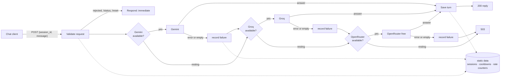

# n8n LLM Failover Router

[](https://github.com/Furnari-Marco/n8n-llm-failover-router/actions/workflows/tests.yml)

> © 2026 Marco Furnari. **All rights reserved.** Published to be read and reviewed, not reused: see [LICENSE](LICENSE).

An n8n workflow that serves a chat endpoint from free LLM tiers. It answers from the first provider that is available, moves to the next one when a provider fails, rests the ones that are out of quota, and keeps every conversation separate and bounded.

## Executive Summary

Free LLM tiers are generous but brittle: a per-minute quota, a daily cap or a bad hour at one provider, and a chat built on it stops answering.

This workflow puts three providers behind one endpoint and makes the switch invisible to the user: same request, same conversation, next provider.

The interesting part is the failure handling: telling a quota from an outage from a bad key, remembering which provider is resting, and doing it on a public endpoint without letting strangers spend the quota.

## Business Impact

Everything below is in the workflow and covered by the tests. It runs on a real n8n in CI, not only in a simulator.

- **One provider failing does not take the chat down.** Gemini, then Groq, then OpenRouter's free router. Each one receives the same full conversation, and the switch happens inside the request that failed.
- **An exhausted provider is not retried on every message.** A quota error rests it for 30 minutes, an outage or timeout for 5. Without this, every request would first wait for a provider that is known to be down.
- **Failures that waiting cannot fix are not rested.** A rejected key or an unknown model gets no cooldown, so a corrected configuration takes effect on the next request.
- **Spend is bounded on a public endpoint.** Rate limits per session and in total, a cap on message length, and requests from browsers on other sites refused before any provider is called.
- **Conversations stay private.** A session id is required, there is no shared default session, and the system prompt cannot be replaced by the caller. Successful executions are not written to the execution log, so conversations are not stored twice.
- **No infrastructure.** Import, add three API keys, publish. State lives in the workflow's own static data.
- **36 tests**: 30 execute the exported workflow in a model of n8n, 6 run it end to end on n8n 2.40.7.

## Tech Stack

`n8n 2.x` (Webhook, IF, Code, HTTP Request, Respond to Webhook) · `JavaScript` · OpenAI-compatible chat APIs (Gemini, Groq, OpenRouter) · `node:test` for the test-suite. No external database, no npm dependencies.

## Architecture & Data Flow



**Validate request** does everything that can turn a request away, before a provider is called: origin, session id, message length, rate limits, the `/status` and `/reset` commands. It also prunes expired sessions, so the store stays bounded without a scheduled job. Its output is the conversation to send, plus which providers are currently available.

**Each provider** is an IF, an HTTP Request and two Code nodes. The HTTP node calls an OpenAI-compatible endpoint. On success, *parse reply* extracts the text; an empty or malformed answer is thrown on purpose, so it takes the same path as an HTTP error.

**Record failure** is the node that makes the cascade work. An n8n error output carries only `{ error }`, not the item that went in, so the next provider would otherwise receive an empty request. The handler classifies the failure, records a cooldown when waiting will help, and rebuilds the conversation from *Validate request*.

| Failure | Reason | Cooldown |
|---|---|---|
| HTTP 429, or a 4xx that mentions a quota | `quota` | 30 minutes |
| HTTP 5xx, timeout, connection refused or reset | `outage` | 5 minutes |
| Any other 4xx: bad key, unknown model | `rejected` | none |
| Empty or malformed answer | `bad_response` | none |

**Save turn** writes the exchange to the session only once a provider has answered. A message that no provider could answer is not kept, so the history never holds a question without a reply.

## API

```http
POST /webhook/llm-chat
Content-Type: application/json

{ "session_id": "3f1c9a2e-7b4d-4c1e-9a55-0d2b6e8f1a47", "message": "What is a webhook?" }
```

The client generates the session id once per visitor, for example with `crypto.randomUUID()`, and sends it with every message.

| Status | Body |
|---|---|
| 200 | `{ session_id, reply, provider, model, usage }` |
| 200 | `/status`: `{ session_id, messages, cooldowns }` · `/reset`: `{ session_id, reset: true }` |
| 400 | `{ error: { code: "invalid_session_id" \| "empty_message", message } }` |
| 403 | `{ error: { code: "origin_not_allowed", message } }` |
| 413 | `{ error: { code: "message_too_long", message } }` |
| 429 | `{ error: { code: "rate_limited", message } }` |
| 503 | `{ error: { code: "all_providers_unavailable", message, last_failure: { provider, reason } } }` |

## Setup

1. **Import** `workflow/llm-failover-router.json` (Workflows > Import from File).
2. **Credentials.** Create one *Header Auth* credential per provider, with name `Authorization` and value `Bearer <API key>`, and select it in each *chat completion* node. All three providers have a free tier.
3. **Origin.** In *Webhook* > *Allowed Origins (CORS)*, replace `https://chat.example.com` with the site that hosts the chat. The workflow reads the same setting to refuse other sites, so it is configured once.
4. **Prompt and limits** are constants at the top of *Validate request*.
5. **Publish** the workflow. Static data is only saved by published workflows, not by test runs in the editor.

## Security

| Threat | Answer |
|---|---|
| A stranger spending the quota | Limits per session (20 per 10 min) and in total (120 per 10 min), 4000 characters per message |
| Rotating session ids to dodge the per-session limit | The total limit does not depend on the session |
| Another website using the endpoint from its visitors' browsers | Refused in the workflow with a 403. CORS alone would not do it: it stops a browser from *reading* the response, but the request still runs and still spends |
| Reading someone else's conversation | Session id required, 8 to 64 characters. No shared default session |
| Replacing the system prompt | The prompt lives only in the workflow. Anything else in the request body is ignored |
| Leaking provider errors to the caller | The 503 names the provider and the reason, not the message |

**What the workflow cannot do:** any key placed in a web page is public, so the chat front end cannot authenticate itself with a secret. A limit per IP address belongs at the reverse proxy (Nginx, Cloudflare), the only layer that knows the client's real address; the workflow cannot trust `X-Forwarded-For`.

## Known limitations

- **Static data is written after the response.** Verified on n8n 2.40: each execution reads static data when it starts and writes the whole object back when it ends, which is after *Respond to Webhook* has already answered. A request that arrives in that gap reads the previous state and then saves over the newer one. In 540 sequential requests it never happened; in 2 of 4 end-to-end runs made while the machine was busy with other work, a provider's cooldown was lost. With requests paced like a person typing, 5 runs out of 5 passed. For people typing into a chat the effect is negligible: the worst case is one extra call to a resting provider. For concurrent traffic, sessions and cooldowns belong in an n8n Data Table or an external store.
- **A quota cooldown is a fixed 30 minutes.** A 429 can mean a per-minute or a per-day limit, and n8n's error item carries neither the response headers nor a `Retry-After`, so the workflow cannot tell which.
- **No streaming.** The reply arrives in one piece.

## Repository layout

```
workflow/llm-failover-router.json   the workflow to import
src/                                the Code nodes, as reviewable JavaScript
  validate-request.js               validation, rate limits, housekeeping, commands
  parse-reply.js                    one per provider, via the __PROVIDER__ placeholder
  record-failure.js                 classification, cooldowns, context hand-over
  save-turn.js
scripts/sync-code.mjs               copies src/ into the workflow export
tests/
  simulator.mjs                     runs the export following its connections
  workflow.test.mjs                 30 tests on the simulator
  e2e.test.mjs                      6 tests on a real n8n
  mock-providers.mjs                scripted Gemini, Groq and OpenRouter
```

The JavaScript lives in `src/` so it can be read and reviewed as code. `npm run sync` writes it into the export, and CI fails if the two differ.

## Running the tests

```
npm test               # 30 tests, milliseconds, no n8n needed
npm run e2e:install    # installs n8n 2.40.7 locally (Node 24)
npm run e2e            # 6 tests on a real n8n
```

**The simulator** executes the exported JSON: the real Code node sources, the real IF and Respond expressions, the real connections. HTTP results are scripted, and the error items reproduce the exact shape n8n 2.40 produces, captured from a real installation, including a stack trace whose line numbers look like status codes.

**The end-to-end suite** imports a copy of the workflow whose HTTP nodes point at `tests/mock-providers.mjs`, publishes it, starts n8n on a throwaway data folder and drives it over HTTP. It checks what a model of n8n cannot: error outputs, static data surviving between executions, and CORS handled by the Webhook node.

## Security & IP Note

Architecture Note: This repository showcases the core logical modules and design patterns of the application. For security and intellectual property reasons, proprietary business logic, full frontend implementation, and deployment configurations have been abstracted or removed.

The system prompt, the allowed origin and the model choices are placeholders. No credentials are included: the export carries none, and a test checks it.

## License

All rights reserved. See [LICENSE](LICENSE).
